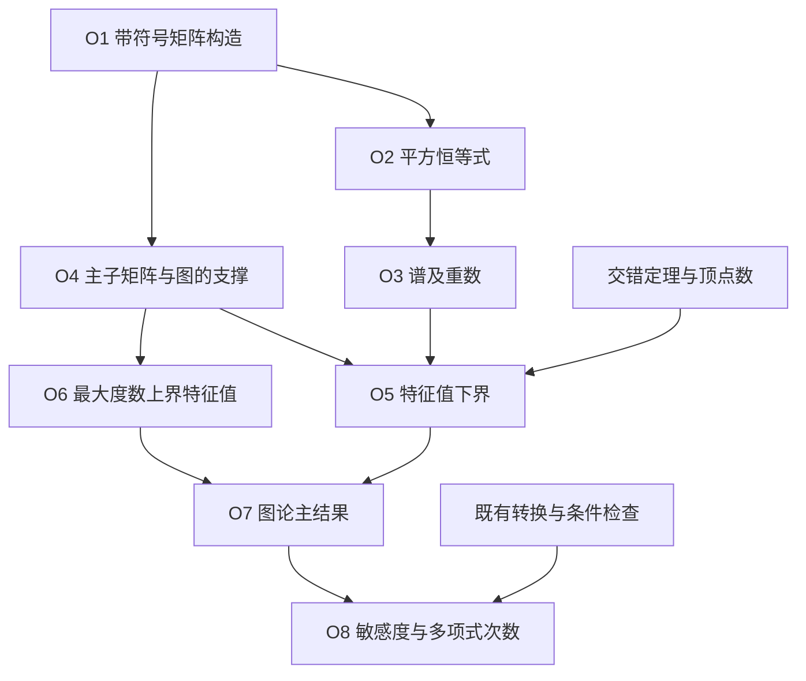

# Case Study: Huang's Sensitivity Theorem

[Overview](../README.md) · [Task specification](task-specification.md) · [Research questions](research-gaps.md)

## Research question

**给定构造以后容易核对，不等于找到构造本身属于 routine。** 本案例用一篇真实论文区分这两个判断，并检查“前作出现相同公式”是否足以覆盖当前证明。

对象为 Huang, *Induced subgraphs of hypercubes and a proof of the Sensitivity Conjecture*。固定分析 [v2](https://arxiv.org/html/1907.00847v2) 的 Theorem 1.1，向后追踪到 Theorem 1.4；另读 [v1](https://arxiv.org/html/1907.00847v1) 核对版本。以下为本仓库的人工分析草案与数学推导，尚未得到独立领域专家复核；不是自动系统结果或新颖性金标准。

## 1. Fix the mathematical target

令 Qₙ 的顶点为 {0,1}ⁿ，两个顶点相邻当且仅当恰好相差一个坐标。目标是：n ≥ 1，S 含有 2ⁿ⁻¹+1 个顶点时，诱导子图 H=Qₙ[S] 满足 Δ(H) ≥ √n。

这是对**所有**这样的 S 的下界。构造**某个**最大度数较小的 S 是另一方向的任务；同一个 √n 出现在这两种结论里，不表示它们互相覆盖。超过阈值的更大 S 可取一个恰有 2ⁿ⁻¹+1 个顶点的子集，利用最大度数的单调性。

## 2. Decompose the main proof

下表中的编号是本案例的分析编号，不是原文逐句编号。每行可以有多个联合前提；不是一条线性的“十步证明”。允许背景为有限维实线性代数、对称矩阵谱理论、交错定理、图的基本定义。

| ID | 需要完成的义务 | 原文位置 | 当前核对与贡献判断 |
| --- | --- | --- | --- |
| O1 | 提供一个对称的带符号矩阵 Aₙ，绝对值恰为 Qₙ 邻接矩阵 | Lemma 2.2；Theorem 1.1 的证明开头 | 给出构造并核对支撑；不因后续计算短就把选取构造算作 routine |
| O2 | 从递推式得到 Aₙ²=nI | Lemma 2.2 的证明 | 给定递推式后的代数补全，见下文 |
| O3 | 从对称性、平方恒等式和零迹得到 ±√n 各占一半的谱 | Lemma 2.2 的证明 | 三项条件共同使用；仅有平方恒等式不够确定重数 |
| O4 | S 限制得到主子矩阵 B，且 B 的支撑对应 H | Theorem 1.1 的证明 | 依赖 O1 与 S 的定义；必须保留对角线为零和条目绝对值约束 |
| O5 | 交错定理与 O3、主子矩阵大小共同推出 λ₁(B)≥√n | Lemma 2.1；Theorem 1.1 的证明 | 给定上述条件后的定理实例化；检查索引 N−m+1 |
| O6 | 从 B 的支撑、条目界和非零特征向量推出 λ₁(B)≤Δ(H) | Lemma 2.3 | 给出最大绝对值坐标论证，见下文 |
| O7 | 合并 O5、O6 得到目标 | Theorem 1.1 末尾 | 标准不等式传递；不据此将整条证明标为 routine |
| O8 | 主结果、限制到最高次单项式的变量、奇偶变换共同推出 s(f)≥√deg(f) | Theorem 1.3–1.4 | 原文明确归于 Gotsman–Linial 的转换；下文展开所需方向 |

图中节点表示义务，入边共同组成该次推断的前提；单独一条入边不声称足以推出结论。

### Concrete completion witnesses

**O1–O3。** 取 A₁=[[0,1],[1,0]]；递推 Aₙ=[[C,I],[I,−C]]，其中 C=Aₙ₋₁。两个对角块对应两份 Qₙ₋₁，单位矩阵块对应两者间的匹配，故绝对值支撑正确。块乘法给出对角块 C²+I、非对角块 C−C=0。因此归纳得到 Aₙ²=nI。实对称性保证可对角化，特征值只能为 ±√n；迹为零且 n>0，故两个重数相等。

这段补全解释的是**给定递推式后的验证**。它没有说明为何会想到在一个子立方体上反转符号，也没有完成该构造的历史优先权检索。

**O5。** n=1 时 H=Q₁、B=A₁，结论直接成立。n≥2 时，写 N=2ⁿ、m=N/2+1。按降序排列特征值，交错定理给出 λ₁(B)≥λ₍N−m+1₎(Aₙ)=λ₍N/2₎(Aₙ)=√n。若把 m 改成 N/2，下界索引变成 N/2+1，对应 −√n；这一具体论证就失去所需的正下界。

**O6。** 对 Bv=λv，选 |vᵢ| 最大的坐标，且 |vᵢ|>0。由支撑和条目界，

$$|\lambda||v_i|\leq\sum_{j\sim_H i}|B_{ij}||v_j|\leq\deg_H(i)|v_i|.$$

约掉非零因子即可。该论证需要限制在 H 的边上，不能用一个谱合适但支撑不合适的矩阵替代。

**O8：展开既有转换的一侧。** 使用 {−1,+1} 值函数和 Walsh 展开；这与原文 {0,1} 值约定的敏感度及非恒定函数次数对应。若 f 的次数为 d>0，取一个非零的 d 次单项式，固定其余变量，得 d 变量函数 g。由于不存在更高次单项式，该顶次系数保留，且 s(g)≤s(f)。令 χ(x)=∏ᵢxᵢ，q(x)=g(x)χ(x)。q 的均值等于 g 的非零顶次系数，因此 q 有一个取值类 S 大于半数。相邻顶点的 χ 反号，所以 S 内部的边都是 g 的敏感边。主定理给出 S 内某点至少 √d 条这样的边，于是 s(f)≥s(g)≥√d。d=0 单独成立。

这个展开核对转换的适用性，不将既有转换重新认领为本案例或 Huang 的创新。

## 3. Compare actual earlier statements

### Same asymptotic expression, different obligations

已下载并阅读 Chung–Füredi–Graham–Seymour 的[作者公开 PDF](https://fanchung.ucsd.edu/ron/papers/88_06_induced_cube.pdf)，重点核对 Theorem 1.1、§3 的构造与 Propositions 3.3–3.4，以及 §4 的下界证明。

| 前作位置 | 与目标的关系 | 为什么不能替代 O1–O7 |
| --- | --- | --- |
| Theorem 1.1、§4 | 同类图的已有对数级下界 | 渐近强度没有达到 √n；本文未认定只是换参数即可得到新界 |
| §3 的上界构造 | 给出小最大度数的具体例子，解释目标尺度 | 存在一个例子与证明所有例子受下界约束，量词和不等式方向不同 |
| Proposition 3.4 | f(𝓕)≠0 时，构造参数 M=max{r(𝓕),t(𝓕)}≥√n | M 是参数，不是 Δ(H)；Proposition 3.3 给的是 Δ(G(𝓕))≤M，不能把这两个不等式拼成 Δ≥√n |

最后一行是一个可明确审查的**错误对应候选**：即使数值上取 n=4、M=3、Δ=1，也满足“Δ≤M 且 M≥√n”，却不满足“Δ≥√n”。这是两个不等式之间不蕴含的数值见证，**不是**声称存在违反 Huang 定理的图。

### A source match is not an independent priority audit

[Gotsman–Linial 的机构记录](https://cris.technion.ac.il/en/publications/the-equivalence-of-two-problems-on-the-cube/)和[出版商页面](https://doi.org/10.1016/0097-3165(92)90060-8)确认问题转换；本次未取得其全文。O8 的来源关系同时由 Huang 的明确归属支持，所需数学方向在上文独立展开。暂不声称核对了 1992 年论文的全部证明或最早发现史。

就本次已读材料而言，O1 的矩阵选取与 O5 的用途连接是需要保留的贡献候选；后续计算和已有转换不能把它们抵消。矩阵是否有更早的等价构造，以及“构造已知但此用途新”的可能性仍须单独核查。Huang 的致谢还明确记录 Sudakov 对 Lemma 2.2 证明的简化；这支持有限的过程记录，不支持分配贡献百分比。

### A later explanation can predate the version being read

Mathews 的 [Clifford 代数解释 v1](https://arxiv.org/html/1907.12357v1)发表于 2019-07-29，指出矩阵可视为 Clifford 代数中某个元素的乘法算子，并给出加权结论。这里核对了导言与 Theorem 1.2；没有核查这些代数工具的完整历史。

它早于本次分析的 Huang v2（2019-08-29），却晚于 Huang 首次公开的 v1（2019-07-01）。因此，“发布时间早于当前所读版本”不足以把它当作解释原始发现的前作。后来的结构解释有助于寻找更早对应，但不能自动将目标的历史归因倒转。加权结论也应另列命题比较，不能因为路线相关就认定没有新增结果；这里不判定其最早优先权。

## 4. Formalization changes the route

已读取 Mathlib 的固定版本 [Archive/Sensitivity.lean](https://github.com/leanprover-community/mathlib4/blob/a98628e16c11f5167f16124105ddce53efa9bfe5/Archive/Sensitivity.lean)，重点为 `f_squared`、`f_matrix`、`g_injective`、`f_image_g`、`exists_eigenvalue` 和 `huang_degree_theorem`。

该文件用线性算子表示递推矩阵，并显式构造一个半维的正特征子空间。它与 S 所张成的坐标子空间维数之和大于 2ⁿ，因此交集中有非零向量；再在其最大绝对值坐标上估计邻居数。它并未直接调用原文的 Cauchy 交错定理。

这提供一个真实的替代路线对照：逐个匹配引理名字会低估结构对应；把“原文使用交错定理”升级成“所有证明都必需交错定理”也不成立。本次仅检查源码，没有本地 Lean 工具链，因此**未重新编译**该文件。

现在的形式化库可用于正确性核对。若任务模拟 2019 年之前的背景，目标定理、由它推出的中间结果、后来的替代证明都不能作为补全依据；从 prompt 隐去名字无法消除预训练知识。

## 5. A diagnostic experiment grounded in this case

输入输出样例见[九项诊断材料](../data/cases/huang-sensitivity.json)。这些是从真实论证派生的任务草案，不是专家金标准，也尚未提交给独立模型运行。

| 条件 | 应观察什么 | 不能据此声称什么 |
| --- | --- | --- |
| 给出正确矩阵，要求补完 O2–O7 | 能否核对条件、索引及补全推导 | 补全成功证明整个构想 routine |
| 给出目标和旧工具，去掉构造 | 能否明确指出尚缺何种矩阵性质 | 模型未找到就说明数学上原创；模型找到就说明历史上已知 |
| 给出上表三类前作候选 | 能否分别识别已有弱界、上界例子、参数界 | 返回同主题文献就算来源覆盖正确 |
| 用无符号邻接矩阵替换构造 | 能否发现缺少所需中间特征值 | 一切合法带符号矩阵都能完成证明 |
| 将顶点阈值改为恰好一半 | 能否给出偶奇分部的零度反例 | 失败仅是证明技巧不够强 |
| 给出 Mathlib 的维数路线 | 能否保留共同构造和目标，允许替代中间步骤 | 名字不同就属于完全不同的数学贡献 |
| 候选来源晚于 v1、早于 v2 | 能否区分目标首次公开时间、所读版本和后续解释 | 只按当前版本日期排序就判为前作 |

预注册的主要观察量应是：错误覆盖的接受率、遗漏条件的发现率、补全推导的有效性，以及是否把“给定构造后的验证”误说成“构造的发现无贡献”。专家先独立判断，再看模型报告。经典案例易被模型记忆，只用于调试任务；泛化评测需要另选近期、未公开的专家材料，并承认无法完全审计训练语料。

## 6. Checks performed and open items

运行 `python3 scripts/check_huang_case.py --check` 可重做[有限检查](../data/cases/huang-sensitivity-checks.json)：整数矩阵恒等式及图支撑、n≤4 的阈值子集穷举、n≤3 的布尔函数次数与敏感度，以及上面的反例诊断。它们只核对有限实例，不替代一般证明、Lean 编译、历史检索或专家评价。

当前已经有主定理到关键连接的逐项分解、具体补全推导、真实前作的错误对应候选和替代证明路线。下一步需要独立专家审阅 O1 的历史对应与发现/验证之分，再在同一材料、同一预算下比较整篇总结、候选检索与条件核对三种方法；尚未有这些方法的性能结果。
